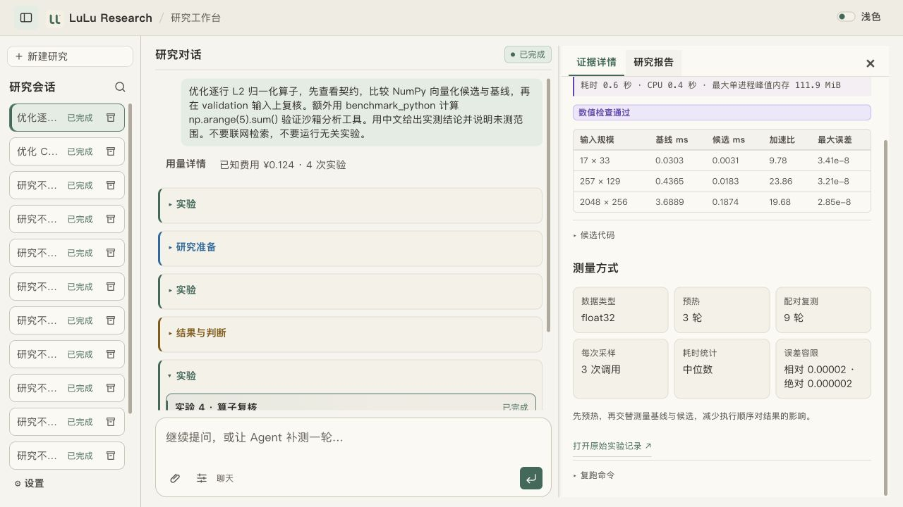

<div align=center>


# LuLu Research

### Evidence behind every research decision

A research agent workbench for Mac. Ask a question, inspect experiments, and keep working in the same conversation.

[中文](README.md) · **English** · [한국어](README.ko.md) · [日本語](README.ja.md)

[](LICENSE)
[](research-agent/pyproject.toml)
[](desktop)

</div>



## From questions to evidence

LuLu connects evidence collection, hypotheses, experiments, verification, and revision. Inspect each measurement, ask follow-up questions, and let the agent choose its next step with the remaining budget in view.

- **Visible research**　Conversations, experiment nodes, and reports sit side by side. Read original records inside the app.
- **Accounted resources**　Track model tokens, estimated CNY costs, search requests, elapsed time, CPU time, and peak memory.
- **Bounded execution**　Generated Python and kernel candidates run in a macOS sandbox with writes confined to the session workspace.
- **Reusable findings**　After a successful turn, LuLu attempts a metered summary call. You choose whether other sessions can discover the summary and read its evidence.

```text
Question → Plan and evidence → Hypothesis → Experiment and verify → Report and summary
                                    ↑               ↓
                                    └─── Revise ────┘
```

## Start with a small question

| Scenario | Research task | Requirements |
| --- | --- | --- |
| CPU kernel optimization | Generate row-wise L2 normalization candidates and verify them against a loop baseline | Mac, no model weights required |
| Imbalanced classification | Compare class weighting through recall, precision, F1, and false positives | CPU, synthetic data with fixed seeds |
| MLX prefix caching | Compare cache configurations and time to first token | Apple Silicon, MLX-LM, and local weights |

> Optimize row-wise L2 normalization. Measure the baseline, compare candidates, then verify correctness on another input set. Report speedup, scope, and reproduction steps.

Speedups are relative to the included loop baseline, not optimized libraries. Generic Python output is not equivalent to fixed benchmark validation.

## Run on Mac

Install Python 3.12 and [uv](https://docs.astral.sh/uv/), then run from the repository root.

```bash
git clone https://github.com/Leemenghao/bohack2026.git
cd bohack2026
uv venv --python 3.12
uv pip install -e ./research-agent
.venv/bin/python -m research_agent.web_server
```

Open the [local workbench](http://127.0.0.1:8766). Configure model and search connections separately in sidebar settings. The model must support OpenAI-compatible tool calls. Search uses the DeepSeek Search / Fetch protocol. Secrets are stored in macOS Keychain.

For a standalone window, install Xcode Command Line Tools and build the app.

```bash
bash desktop/build.sh
```

Open LuLu Research.app in the repository root. It still depends on this checkout and Python environment, so it is not yet a self-contained distribution.

## A place for every result

| Directory | Contents |
| --- | --- |
| `web/` | Pages, styles, and frontend interactions |
| `desktop/` | macOS window and app icon |
| `research-agent/` | Backend, agent, experiment tools, tests, and development notes |
| `runs/` | Local session index, reports, evidence, and resource ledgers, excluded from Git |

The shared workspace for a session lives at `runs/<session_id>/workspace/`. Turn artifacts live at `runs/<run_id>/`, linked through SQLite. Sharing is off by default and managed through the session context menu. Archiving or disabling sharing blocks future reads but cannot retract content already read by another session.

## Current scope

LuLu is an evolving local workbench. Models and search still use online APIs. Generated code runs through macOS Seatbelt for up to 30 seconds without network or host-secret access. Fixed classification and MLX tools run in the trusted backend outside the generic code sandbox.

Costs cover known prices and are estimates, not invoices or hard spending caps. GPU time is not measured. SSH execution, cloud synchronization, automatic model routing, and cross-platform sandboxes are not implemented.

[Development and configuration guide in Chinese](research-agent/docs/development.md) · [Backend tools](research-agent/research_agent/research/README.md)

## Develop together

Make focused commits on feature branches, run checks, and open a PR to main. Avoid overwriting another contributor branch.

```bash
.venv/bin/python -m unittest discover -s research-agent/tests
```

## Credits and license

LuLu is adapted from [LangChain Deep Agents](https://github.com/langchain-ai/deepagents). The README structure takes inspiration from [GPT Researcher](https://github.com/assafelovic/gpt-researcher) and [DeerFlow](https://github.com/bytedance/deer-flow).

Released under the [MIT license](LICENSE), with upstream copyright notices retained.
