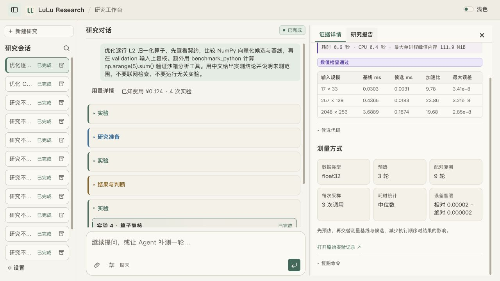

<div align=center>


# LuLu Research

### 모든 연구 판단에 확인할 수 있는 근거를

Mac에서 사용하는 연구 Agent 워크벤치. 질문을 던지고 실험을 살펴보며 같은 대화에서 연구를 이어갑니다.

[中文](README.md) · [English](README.en.md) · **한국어** · [日本語](README.ja.md)

[](LICENSE)
[](research-agent/pyproject.toml)
[](desktop)

</div>



## 질문에서 근거까지

LuLu는 자료 수집, 가설, 실험, 검증, 수정을 하나의 연구 과정으로 연결합니다. 각 측정값을 확인하고 후속 질문을 하며 남은 예산에 따라 다음 단계를 결정하도록 맡길 수 있습니다.

- **보이는 연구 과정**　대화, 실험 단계, 보고서를 나란히 보여주고 앱 안에서 원본 기록을 읽습니다.
- **확인 가능한 사용량**　모델 token, 인민폐 기준 예상 비용, 검색 요청, 경과 시간, CPU 시간과 최대 메모리를 기록합니다.
- **범위가 정해진 실행**　생성된 Python과 연산자 후보는 macOS 샌드박스에서 실행하며 파일 쓰기는 해당 세션 작업 공간으로 제한합니다.
- **재사용할 수 있는 경험**　성공한 턴이 끝나면 사용량에 포함되는 요약 생성을 시도합니다. 다른 세션의 요약 검색과 근거 읽기 허용 여부는 사용자가 정합니다.

```text
연구 질문 → 계획과 근거 → 가설 → 실험과 검증 → 보고서와 세션 요약
                           ↑        ↓
                           └─ 수정 ─┘
```

## 작은 질문으로 시작하기

| 시나리오 | 연구 내용 | 실행 조건 |
| --- | --- | --- |
| CPU 연산자 최적화 | 행별 L2 정규화 후보를 생성하고 루프 기준 구현과 비교 및 검증 | Mac, 모델 가중치 다운로드 불필요 |
| 불균형 분류 | 클래스 가중치에 따른 재현율, 정밀도, F1, 거짓 양성 비교 | CPU, 고정 시드로 생성한 합성 데이터 |
| MLX 접두사 캐시 | 캐시 설정과 첫 token 지연 시간 비교 | Apple Silicon, MLX-LM, 로컬 가중치 |

> 행별 L2 정규화 연산자를 최적화해 주세요. 기준 구현을 측정하고 후보를 비교한 뒤 다른 입력 집합에서 정확성을 검증해 주세요. 속도 향상, 적용 범위와 재현 방법을 정리해 주세요.

속도 향상은 프로젝트의 루프 기준 구현 대비 수치이며 최적화된 라이브러리를 능가한다는 뜻이 아닙니다. 일반 Python 실행 결과는 고정 benchmark의 검증 결과와 구분합니다.

## Mac에서 실행하기

Python 3.12와 [uv](https://docs.astral.sh/uv/)를 준비한 뒤 저장소 루트에서 실행합니다.

```bash
git clone https://github.com/Leemenghao/bohack2026.git
cd bohack2026
uv venv --python 3.12
uv pip install -e ./research-agent
.venv/bin/python -m research_agent.web_server
```

[로컬 워크벤치](http://127.0.0.1:8766)를 엽니다. 사이드바 설정에서 모델과 검색 연결을 각각 구성합니다. 모델은 OpenAI 호환 도구 호출을 지원해야 하며 검색은 DeepSeek Search / Fetch 프로토콜을 사용합니다. API Key는 macOS 키체인에 저장합니다.

독립 창을 사용하려면 Xcode Command Line Tools를 설치하고 앱을 빌드합니다.

```bash
bash desktop/build.sh
```

저장소 루트의 LuLu Research.app을 엽니다. 현재 앱은 이 저장소와 Python 환경에 의존하며 독립 배포용 설치 패키지는 아닙니다.

## 결과마다 정해진 자리

| 디렉터리 | 내용 |
| --- | --- |
| `web/` | 페이지, 스타일과 프런트엔드 상호작용 |
| `desktop/` | macOS 창과 앱 아이콘 |
| `research-agent/` | 백엔드, Agent, 실험 도구, 테스트와 개발 문서 |
| `runs/` | 로컬 세션 인덱스, 보고서, 근거와 자원 사용 기록, Git에서 제외 |

세션 공용 작업 공간은 `runs/<session_id>/workspace/`에 있습니다. 각 턴의 근거는 `runs/<run_id>/`에 저장하고 SQLite로 연결합니다. 공유는 기본적으로 꺼져 있으며 세션의 우클릭 메뉴에서 관리합니다. 보관하거나 공유를 끄면 이후 읽기를 차단하지만 다른 세션이 이미 읽은 내용을 회수하지는 않습니다.

## 현재 범위

LuLu는 개발 중인 로컬 워크벤치입니다. 모델과 검색에는 온라인 API가 필요합니다. 생성 코드는 macOS Seatbelt에서 최대 30초 동안 실행하며 네트워크와 호스트 비밀 정보에 접근할 수 없습니다. 고정 분류 및 MLX 도구는 일반 코드 샌드박스 밖의 신뢰된 백엔드에서 실행합니다.

비용은 알려진 단가에 따른 추정치이며 실제 청구액이나 엄격한 지출 상한이 아닙니다. GPU 시간은 아직 측정하지 않습니다. SSH 실행, 클라우드 동기화, 자동 모델 라우팅과 크로스 플랫폼 샌드박스는 구현하지 않았습니다.

[중국어 개발 및 설정 안내](research-agent/docs/development.md) · [백엔드 도구](research-agent/research_agent/research/README.md)

## 함께 개발하기

기능 브랜치에서 작은 단위로 커밋하고 검증을 통과한 뒤 main으로 PR을 보냅니다. 다른 기여자의 브랜치를 덮어쓰지 않습니다.

```bash
.venv/bin/python -m unittest discover -s research-agent/tests
```

## 감사와 라이선스

LuLu는 [LangChain Deep Agents](https://github.com/langchain-ai/deepagents)를 바탕으로 수정했습니다. README 구성은 [GPT Researcher](https://github.com/assafelovic/gpt-researcher)와 [DeerFlow](https://github.com/bytedance/deer-flow)를 참고했습니다.

상위 프로젝트의 저작권 고지를 유지하며 [MIT 라이선스](LICENSE)로 배포합니다.
