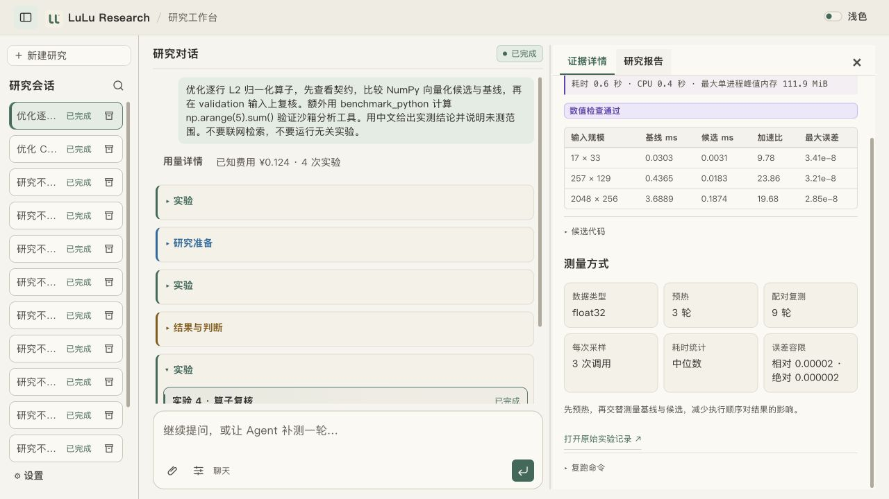

<div align=center>


# LuLu Research

### 让每一个研究判断，都有证据可查

一个在 Mac 上工作的科研 Agent 工作台。提出问题，观察实验，在同一会话里继续研究。

**中文** · [English](README.en.md) · [한국어](README.ko.md) · [日本語](README.ja.md)

[](LICENSE)
[](research-agent/pyproject.toml)
[](desktop)

</div>



## 从问题走到证据

LuLu 将资料检索、假设、实验、验证和修正放进一条可追溯的研究过程。你可以查看每次测量、继续追问，也可以让它根据剩余预算决定下一步。

- **看得见的研究**　对话、实验节点与报告并排展示，原始记录在应用内阅读。
- **算得清的用量**　记录模型 token、人民币估算费用、检索请求、实验耗时、CPU 时间与峰值内存。
- **有边界的执行**　模型生成的 Python 与算子候选在 macOS 沙箱运行，文件写入限定在本会话工作区。
- **可以复用的经验**　每轮成功后尝试生成摘要，计入模型用量。你决定是否允许其他会话检索摘要并只读查证。

```text
研究问题 → 规划与证据 → 提出假设 → 实验与验证 → 报告与会话摘要
                                ↑       ↓
                                └─ 修正 ─┘
```

## 先跑一个小问题

当前提供三个实验场景。

| 场景 | 研究内容 | 执行条件 |
| --- | --- | --- |
| CPU 算子优化 | 生成逐行 L2 归一化候选，对比循环基线并复核数值 | Mac，无需下载模型权重 |
| 不平衡分类 | 比较类别加权的召回率、精确率、F1 和误报 | CPU，固定种子的合成数据 |
| MLX 前缀缓存 | 比较缓存配置与首 token 延迟 | Apple Silicon、MLX-LM 与本地权重 |

可以从这段问题开始。

> 优化逐行 L2 归一化算子。先测基线，再比较候选，在另一组输入上复核正确性。说明加速幅度、适用范围和复跑方法。

加速比的参照是本项目的循环基线，不代表超越优化库。沙箱 Python 输出也不等同于经过固定 benchmark 验证的结论。

## 在 Mac 上启动

准备 Python 3.12 和 [uv](https://docs.astral.sh/uv/)。在仓库根目录执行。

```bash
git clone https://github.com/Leemenghao/bohack2026.git
cd bohack2026
uv venv --python 3.12
uv pip install -e ./research-agent
.venv/bin/python -m research_agent.web_server
```

打开 [本地工作台](http://127.0.0.1:8766)。在侧栏设置中分别配置模型与资料检索连接。模型需要支持 OpenAI 兼容的工具调用接口，检索使用 DeepSeek Search / Fetch 协议。密钥保存到 macOS 钥匙串。

需要独立窗口时，安装 Xcode Command Line Tools 后构建应用。

```bash
bash desktop/build.sh
```

打开仓库根目录生成的 LuLu Research.app。当前应用依赖这个检出目录与 Python 环境，尚不是独立分发安装包。

## 清楚地保存每一步

| 目录 | 内容 |
| --- | --- |
| `web/` | 页面、样式与前端交互 |
| `desktop/` | macOS 窗口与应用图标 |
| `research-agent/` | 后端、Agent、实验工具、测试与开发说明 |
| `runs/` | 本机会话索引、报告、证据与资源账本，不提交到 Git |

会话共享工作区位于 `runs/<session_id>/workspace/`。各轮证据保存在 `runs/<run_id>/`，SQLite 将它们关联起来。共享默认关闭，右键会话打开摘要即可管理。归档或关闭共享会阻止后续跨会话读取，已经读入其他会话的内容不会自动撤回。

## 当前边界

这是一个持续迭代的本机研究工作台。模型和检索仍需在线 API。生成代码使用 macOS Seatbelt，执行最长 30 秒，禁用网络和宿主密钥访问。固定分类与 MLX 工具由可信后端运行，不属于通用代码沙箱。

费用是已知价格部分的估算，不是实际账单或硬性扣款上限。GPU 时间尚未计量。SSH 执行、云端同步、自动模型路由和跨平台沙箱尚未接入。

[开发与配置说明](research-agent/docs/development.md) · [后端工具结构](research-agent/research_agent/research/README.md)

## 一起开发

在功能分支上做小步提交，验证通过后发起到 main 的 PR。避免直接覆盖队友的分支。

```bash
.venv/bin/python -m unittest discover -s research-agent/tests
```

## 致谢与许可

LuLu 基于 [LangChain Deep Agents](https://github.com/langchain-ai/deepagents) 修改。项目首页的组织方式参考了 [GPT Researcher](https://github.com/assafelovic/gpt-researcher) 与 [DeerFlow](https://github.com/bytedance/deer-flow)。

按 [MIT 许可证](LICENSE)发布，保留上游版权声明。
