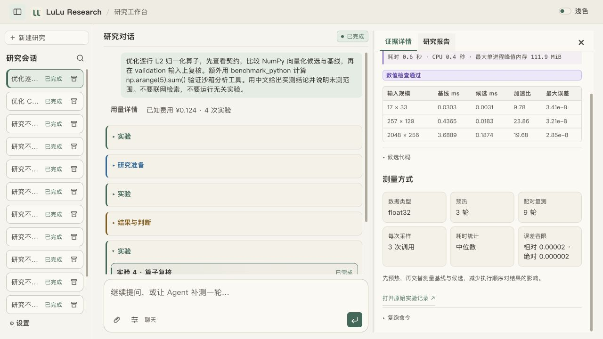

<div align=center>


# LuLu Research

### 研究の判断を、確かめられる根拠とともに

Macで動く研究Agentワークベンチ。問いを立て、実験を確かめ、同じ会話で研究を続けられます。

[中文](../../README.md) · [English](README.en.md) · [한국어](README.ko.md) · **日本語**

[](../../LICENSE)
[](../../research-agent/pyproject.toml)
[](../../desktop)

</div>



## 問いから根拠へ

LuLuは資料収集、仮説、実験、検証、修正をひとつの研究過程につなぎます。測定値を確認し、追加の質問をしながら、残りの予算に応じて次の一手を選ばせることができます。

- **見える研究過程**　会話、実験ノード、報告書を並べて表示し、元の記録もアプリ内で読めます。
- **確認できる使用量**　モデルのtoken、人民元での推定費用、検索リクエスト、経過時間、CPU時間、ピークメモリを記録します。
- **範囲を定めた実行**　生成したPythonと演算子候補はmacOSのサンドボックスで実行し、ファイルの書き込み先を会話の作業領域に限定します。
- **再利用できる知見**　正常に終了したターンでは、使用量に計上する要約生成を試みます。他の会話による要約検索と根拠の読み取りは、ユーザーが許可します。

```text
研究の問い → 計画と根拠 → 仮説 → 実験と検証 → 報告書と会話の要約
                           ↑        ↓
                           └─ 修正 ─┘
```

## 小さな問いから始める

| シナリオ | 研究内容 | 実行条件 |
| --- | --- | --- |
| CPU演算子の最適化 | 行ごとのL2正規化候補を生成し、ループによる基準実装と比較して検証 | Mac、モデル重みの取得は不要 |
| 不均衡分類 | クラス重みによる再現率、適合率、F1、偽陽性の変化を比較 | CPU、固定シードの合成データ |
| MLXプレフィックスキャッシュ | キャッシュ設定と最初のtokenまでの遅延を比較 | Apple Silicon、MLX-LM、ローカルの重み |

> 行ごとのL2正規化演算子を最適化してください。まず基準実装を測定し、候補を比較した後、別の入力集合で正しさを検証してください。高速化の幅、適用範囲、再実行の方法をまとめてください。

高速化の倍率は本プロジェクトのループ基準実装に対する値であり、最適化済みライブラリを上回るという意味ではありません。汎用Pythonの出力は、固定benchmarkで検証した結果とは区別します。

## Macで起動する

Python 3.12と[uv](https://docs.astral.sh/uv/)を用意し、リポジトリのルートで実行します。

```bash
git clone https://github.com/Leemenghao/bohack2026.git
cd bohack2026
uv venv --python 3.12
uv pip install -e ./research-agent
.venv/bin/python -m research_agent.web_server
```

[ローカルのワークベンチ](http://127.0.0.1:8766)を開きます。サイドバーの設定でモデルと検索の接続を個別に登録します。モデルにはOpenAI互換のツール呼び出しが必要です。検索はDeepSeek Search / Fetchのプロトコルを使い、API KeyはmacOSキーチェーンに保存します。

独立したウィンドウを使う場合は、Xcode Command Line Toolsをインストールしてアプリをビルドします。

```bash
bash desktop/build.sh
```

ルートのLuLu Research.appは開発用ランチャーです。独立したインストーラーは`.venv/bin/python desktop/package.py`でビルドします。`desktop/dist/`のDMGにはPythonと依存関係が含まれ、Apple SiliconとmacOS 26以降に対応します。キー、研究履歴、モデルの重みは含みません。[中国語のパッケージ作成ガイド](../../desktop/README.md)も参照してください。

## 結果を迷わず探せるように

| ディレクトリ | 内容 |
| --- | --- |
| `web/` | ページ、スタイル、フロントエンドの操作 |
| `desktop/` | macOSウィンドウとアプリアイコン |
| `research-agent/` | バックエンド、Agent、実験ツール、テスト、開発資料 |
| `runs/` | ローカルの会話索引、報告書、根拠、資源使用記録、Gitの対象外 |

会話の共通作業領域は`runs/<session_id>/workspace/`です。各ターンの根拠は`runs/<run_id>/`に保存し、SQLiteで関連付けます。共有は初期状態で無効です。会話を右クリックして管理できます。アーカイブまたは共有の解除で以降の読み取りを止められますが、他の会話が読み込んだ内容は回収されません。

## 現在の範囲

LuLuは開発中のローカルワークベンチです。モデルと検索にはオンラインAPIを使います。生成コードはmacOS Seatbeltで最大30秒間実行し、ネットワークやホストの機密情報へのアクセスを禁止します。固定の分類ツールとMLXツールは、汎用コード用サンドボックスの外にある信頼済みバックエンドで実行します。

費用は判明している単価による推定であり、実際の請求額や厳密な支出上限ではありません。GPU時間は未計測です。SSH実行、クラウド同期、自動モデルルーティング、クロスプラットフォームのサンドボックスは未実装です。

[中国語の開発と設定ガイド](../../research-agent/docs/development.md) · [バックエンドのツール](../../research-agent/research_agent/research/README.md)

## 一緒に開発する

機能ブランチで小さくコミットし、検証後にmainへのPRを作成します。他の開発者のブランチを上書きしないでください。

```bash
.venv/bin/python -m unittest discover -s research-agent/tests
```

## 謝辞とライセンス

LuLuは[LangChain Deep Agents](https://github.com/langchain-ai/deepagents)を基に改修しています。READMEの構成は[GPT Researcher](https://github.com/assafelovic/gpt-researcher)と[DeerFlow](https://github.com/bytedance/deer-flow)を参考にしました。

上流の著作権表示を保持し、[MITライセンス](../../LICENSE)で公開しています。
